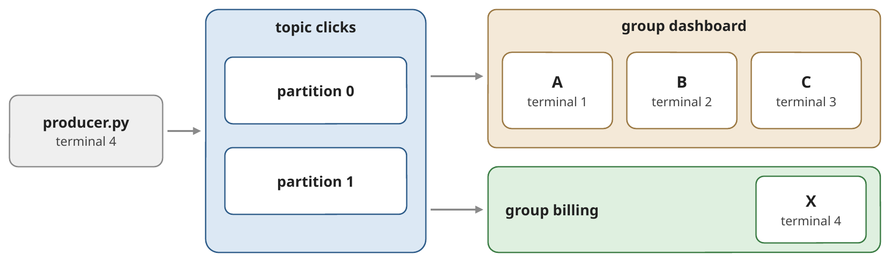
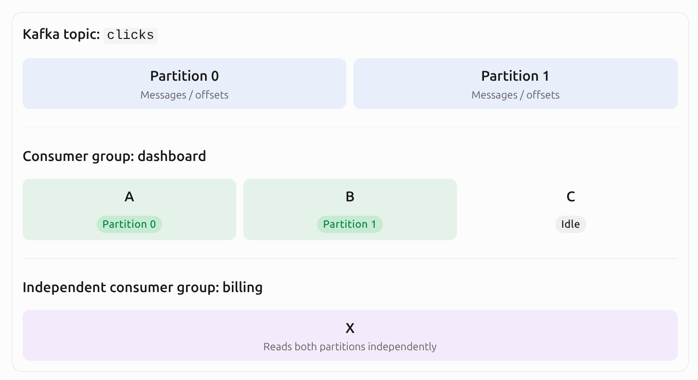

# Exercise 5 Messaging Platforms: Fundamentals

> ## Part 1 — Kafka quick start (guided, not graded)
> 
> Four steps, one idea each; Part 2 builds on all four. In every step,
> **predict** first, then run the commands, then check.
> 
> Open a terminal in `clients/` with the virtual environment active. The
> broker runs at `localhost:9092`. The Kafka command-line tools run inside the
> `kafka` container (`docker exec -it kafka …`); the Kafka UI
> (<http://localhost:8080>) shows the same information in the browser.
> 
> ### 1. A topic is a set of logs
> 
> ```bash
> docker exec -it kafka kafka-topics.sh --bootstrap-server localhost:9092 \
>   --create --topic clicks --partitions 2 --replication-factor 1
> 
> docker exec -it kafka kafka-topics.sh --bootstrap-server localhost:9092 \
>   --describe --topic clicks
> ```
> 
> The topic `clicks` has two **partitions**: two append-only logs in which
> every new event gets the next **offset** (0, 1, 2, …). Partitions are the
> unit of parallelism. (`--replication-factor 1`: one copy of each
> partition, because we have a single broker.) Kafka keeps events for 7 days
> by default (`retention.ms`), whether anybody read them or not.
> ### 2. Keys decide the partition
> 
> `producer.py` sends 20 click events with the keys `user-1` … `user-4` and
> prints the partition and offset of each event.
> 
> *Predict:* run it twice. Does `user-1` land in the same partition both
> times? Where do events without a key go?
> 
> ```bash
> python3 producer.py
> python3 producer.py
> python3 producer.py --no-key
> ```
> 
> > **Same key → same partition → same order.** The partition is
> > `hash(key) mod number of partitions`, on every run. Events without a key
> > are spread over both partitions: the order per user is lost.

<details>
<summary style="font-weight: bold;"><i>Predict:</i> run it twice. Does <code>user-1</code> land in the same partition both times? Where do events without a key go?</summary>

#### Expectation:
Running the file twice should result in all users ending up in the same partition.

#### Observation:
The prediction was correct: all users ended up in the same partition.
<details>
<summary><i>Output</i></summary>

~~~text
key=user-1    ->  partition 0  offset 0
key=user-3    ->  partition 1  offset 0
key=user-2    ->  partition 0  offset 1
key=user-1    ->  partition 0  offset 2
key=user-1    ->  partition 0  offset 3
key=user-4    ->  partition 1  offset 1
key=user-1    ->  partition 0  offset 4
key=user-2    ->  partition 0  offset 5
key=user-1    ->  partition 0  offset 6
key=user-2    ->  partition 0  offset 7
key=user-4    ->  partition 1  offset 2
key=user-4    ->  partition 1  offset 3
key=user-3    ->  partition 1  offset 4
key=user-2    ->  partition 0  offset 8
key=user-4    ->  partition 1  offset 5
key=user-3    ->  partition 1  offset 6
key=user-2    ->  partition 0  offset 9
key=user-1    ->  partition 0  offset 10
key=user-4    ->  partition 1  offset 7
key=user-3    ->  partition 1  offset 8
sent 20 events to topic 'clicks'
key=user-1    ->  partition 0  offset 11
key=user-3    ->  partition 1  offset 9
key=user-2    ->  partition 0  offset 12
key=user-1    ->  partition 0  offset 13
key=user-1    ->  partition 0  offset 14
key=user-4    ->  partition 1  offset 10
key=user-1    ->  partition 0  offset 15
key=user-2    ->  partition 0  offset 16
key=user-1    ->  partition 0  offset 17
key=user-2    ->  partition 0  offset 18
key=user-4    ->  partition 1  offset 11
key=user-4    ->  partition 1  offset 12
key=user-3    ->  partition 1  offset 13
key=user-2    ->  partition 0  offset 19
key=user-4    ->  partition 1  offset 14
key=user-3    ->  partition 1  offset 15
key=user-2    ->  partition 0  offset 20
key=user-1    ->  partition 0  offset 21
key=user-4    ->  partition 1  offset 16
key=user-3    ->  partition 1  offset 17
sent 20 events to topic 'clicks'
~~~
</details>

#### Running it without a key:
Without a key, `kafka` distributes messages across the available partitions using its unkeyed partitioning strategy. Both partitions should recieve messages.

`Kafka` uses the message key to determine which partition should receive a message. The producer explicitly configures the `murmur2_random` partitioner, which uses a hash of the key for keyed messages.

Consequently:
- The same key consistently maps to the same partition.
- Different keys may map to the same partition.
- Messages with the same key preserve their relative order within that partition.
- Messages without keys are distributed without guaranteeing that related events reach the same partition.

> #### Key takeaway:
> Same key $\rightarrow$ Same partition $\rightarrow$ Preserved order.
</details>

> ### 3. Consumer groups share the work
> 
> `consumer.py` joins a consumer group and prints the partitions it gets and
> every event it reads. Keep your terminal for the producer and open three
> more in `clients/` (virtual environment active). Start `A`, `B` and `C`
> one after the other; wait each time until the new consumer prints its
> partitions.
> 
> *Predict:* three consumers, two partitions. Who gets what?
> 
> ```bash
> python3 consumer.py --group dashboard --name A
> python3 consumer.py --group dashboard --name B
> python3 consumer.py --group dashboard --name C
> ```
> 
> 
> 
> Send events (`python3 producer.py`): who reads which keys? Then start a
> consumer of a **second** group in the producer's terminal:
> `python3 consumer.py --group billing --name X`. Which events does `X` read?
> 
> > **Within a group, one partition → one consumer.** `C` stays idle: more
> > consumers than partitions do not help. Every join or leave triggers a
> > **rebalance**, and a partition can move to another consumer. Another
> > group (`X`) reads all events on its own, without changing `dashboard`.

<details>
<summary style="font-weight: bold;"><i>Predict:</i> three consumers, two partitions. Who gets what?</summary>

#### Expectation:
There are only two partitions available, so `kafka` can assign work to at most two consumers within the same consumer group at a time.
This means that if *Consumer A* is assigned to **Partition 0** and *Consumer B* is assigned to **Partition 1**, *Consumer C* has no partition to be assigned to.

#### Observation:
What was expected, actually happened.

<details>
<summary><i>Outputs</i></summary>

##### Terminal 1:
Command: `python3 consumer.py --group dashboard --name A`
~~~text
[A] joined group 'dashboard' on topic 'clicks' (Ctrl+C to stop)
[A] assigned partitions: [0, 1]
[A] revoked partitions:  [0, 1]
[A] assigned partitions: [0]
[A] revoked partitions:  [0]
[A] assigned partitions: [0]
[A] partition 0 offset   28  key=user-1   seq=1
[A] partition 0 offset   29  key=user-2   seq=3
[A] partition 0 offset   30  key=user-1   seq=4
[A] partition 0 offset   31  key=user-1   seq=5
[A] partition 0 offset   32  key=user-1   seq=7
[A] partition 0 offset   33  key=user-2   seq=8
[A] partition 0 offset   34  key=user-1   seq=9
[A] partition 0 offset   35  key=user-2   seq=10
[A] partition 0 offset   36  key=user-2   seq=14
[A] partition 0 offset   37  key=user-2   seq=17
[A] partition 0 offset   38  key=user-1   seq=18
[A] revoked partitions:  [0]
[A] stopped after 11 events
(venv) pleve@pleve-ASUS-Zenbo
~~~

##### Terminal 2:
Command: `python3 consumer.py --group dashboard --name B`
~~~text
[B] joined group 'dashboard' on topic 'clicks' (Ctrl+C to stop)
[B] assigned partitions: [1]
[B] revoked partitions:  [1]
[B] assigned partitions: [1]
[B] partition 1 offset   32  key=user-3   seq=2
[B] partition 1 offset   33  key=user-4   seq=6
[B] partition 1 offset   34  key=user-4   seq=11
[B] partition 1 offset   35  key=user-4   seq=12
[B] partition 1 offset   36  key=user-3   seq=13
[B] partition 1 offset   37  key=user-4   seq=15
[B] partition 1 offset   38  key=user-3   seq=16
[B] partition 1 offset   39  key=user-4   seq=19
[B] partition 1 offset   40  key=user-3   seq=20
[B] revoked partitions:  [1]
[B] assigned partitions: [0]
^C[B] revoked partitions:  [0]
[B] stopped after 9 events

~~~

### Terminal 3&mdash;Before rebalancing:
Command: `python3 consumer.py --group dashboard --name C`
~~~text
[C] joined group 'dashboard' on topic 'clicks' (Ctrl+C to stop)
[C] assigned partitions: none (idle)
~~~

##### Terminal 3&mdash;After rebalancing:
Command: `python3 consumer.py --group dashboard --name C`. State after KeyboardInterrup on `terminal 1` or `terminal 2`.
~~~text
[C] joined group 'dashboard' on topic 'clicks' (Ctrl+C to stop)
[C] assigned partitions: none (idle)
[C] revoked partitions:  []
[C] assigned partitions: [1]
[C] partition 1 offset   37  key=user-4   seq=15
[C] partition 1 offset   38  key=user-3   seq=16
[C] partition 1 offset   39  key=user-4   seq=19
[C] partition 1 offset   40  key=user-3   seq=20
[C] revoked partitions:  [1]
[C] assigned partitions: [0, 1]
[C] partition 1 offset   37  key=user-4   seq=15
[C] partition 1 offset   38  key=user-3   seq=16
[C] partition 1 offset   39  key=user-4   seq=19
[C] partition 1 offset   40  key=user-3   seq=20
[C] revoked partitions:  [0, 1]
[C] stopped after 8 events
~~~

##### Terminal 4:
Command: `python3 producer.py`
~~~text
key=user-1    ->  partition 0  offset 28
key=user-3    ->  partition 1  offset 32
key=user-2    ->  partition 0  offset 29
key=user-1    ->  partition 0  offset 30
key=user-1    ->  partition 0  offset 31
key=user-4    ->  partition 1  offset 33
key=user-1    ->  partition 0  offset 32
key=user-2    ->  partition 0  offset 33
key=user-1    ->  partition 0  offset 34
key=user-2    ->  partition 0  offset 35
key=user-4    ->  partition 1  offset 34
key=user-4    ->  partition 1  offset 35
key=user-3    ->  partition 1  offset 36
key=user-2    ->  partition 0  offset 36
key=user-4    ->  partition 1  offset 37
key=user-3    ->  partition 1  offset 38
key=user-2    ->  partition 0  offset 37
key=user-1    ->  partition 0  offset 38
key=user-4    ->  partition 1  offset 39
key=user-3    ->  partition 1  offset 40
sent 20 events to topic 'clicks'
~~~
</details>

`Kafka` consumer groups allow multiple consumers to share the processing workload.

There are two important rules:
1. Within a consumer group, each partition can be assigned to only one consumer at a time.
2. Different consumer groups independently consume the same topic.

Whenever a consumer joins or leaves a group, Kafka can trigger a rebalance (this is why we have now an output in `terminal 3`). During rebalancing, partitions are reassigned between the remaining consumers.


<center style="font-style: italic;">AI Generated illustration of the architecture</center>
</details>

> ### 4. Offsets: where a group continues
> 
> Stop all consumers (`Ctrl+C`).
> 
> *Predict:* you send 20 more events. Where
> does `dashboard` continue when `A` comes back?
> 
> ```bash
> python3 producer.py
> 
> docker exec -it kafka kafka-consumer-groups.sh --bootstrap-server localhost:9092 \
>   --describe --group dashboard
> ```
> 
> Per partition: `CURRENT-OFFSET` (where the group is), `LOG-END-OFFSET` (the
> end of the log) and `LAG` (the difference). Start `A` again and check your
> prediction. Then replay the whole topic for `billing`, and start `X` again:
> 
> ```bash
> docker exec -it kafka kafka-consumer-groups.sh --bootstrap-server localhost:9092 \
>   --group billing --topic clicks --reset-offsets --to-earliest --execute
> ```
> 
> > **The committed offset is the group's position in the log, stored in
> > Kafka.** A consumer continues where its group stopped; the lag says how
> > far behind it is. Reading deletes nothing: a reset (or a new group) reads
> > the history again, e.g. to fill a new service or to reprocess after a bug
> > fix, without affecting other groups.

<details>
<summary style="font-weight: bold;"><i>Predict:</i> you send 20 more events. Where does <code>dashboard</code> continue when <code>A</code> comes back?</summary>

**Output** for `docker exec -it kafka kafka-consumer-groups.sh --bootstrap-server localhost:9092 --describe --group dashboard`:
~~~text
Consumer group 'dashboard' has no active members.

GROUP           TOPIC           PARTITION  CURRENT-OFFSET  LOG-END-OFFSET  LAG             CONSUMER-ID     HOST            CLIENT-ID
dashboard       clicks          1          50              59              9               -               -               -
dashboard       clicks          0          50              61              11              -               -               -
~~~

#### Expectation:
*Consumer A* continues from where it was left, it does not start automatically from the begining.

#### Observation:
Command: `python3 consumer.py --group dashboard --name A`.
~~~text
[A] joined group 'dashboard' on topic 'clicks' (Ctrl+C to stop)
[A] assigned partitions: [0, 1]
[A] partition 0 offset   50  key=user-1   seq=1
[A] partition 0 offset   51  key=user-2   seq=3
[A] partition 0 offset   52  key=user-1   seq=4
[A] partition 0 offset   53  key=user-1   seq=5
[A] partition 0 offset   54  key=user-1   seq=7
[A] partition 0 offset   55  key=user-2   seq=8
[A] partition 0 offset   56  key=user-1   seq=9
[A] partition 0 offset   57  key=user-2   seq=10
[A] partition 0 offset   58  key=user-2   seq=14
[A] partition 0 offset   59  key=user-2   seq=17
[A] partition 0 offset   60  key=user-1   seq=18
[A] partition 1 offset   50  key=user-3   seq=2
[A] partition 1 offset   51  key=user-4   seq=6
[A] partition 1 offset   52  key=user-4   seq=11
[A] partition 1 offset   53  key=user-4   seq=12
[A] partition 1 offset   54  key=user-3   seq=13
[A] partition 1 offset   55  key=user-4   seq=15
[A] partition 1 offset   56  key=user-3   seq=16
[A] partition 1 offset   57  key=user-4   seq=19
[A] partition 1 offset   58  key=user-3   seq=20
[A] revoked partitions:  [0, 1]
[A] stopped after 20 events
~~~

#### Expectation&mdash;reseting `billing`:
*X* starts reading the topic from the begining, rather than from the previous position.

#### Observation:
Command: `python3 consumer.py --group billing --name X`.
~~~text
[X] joined group 'billing' on topic 'clicks' (Ctrl+C to stop)
[X] assigned partitions: [0, 1]
[X] partition 0 offset    0  key=user-1   seq=1
[X] partition 0 offset    1  key=user-2   seq=3
[X] partition 0 offset    2  key=user-1   seq=4
[X] partition 0 offset    3  key=user-1   seq=5
[X] partition 0 offset    4  key=user-1   seq=7
[X] partition 0 offset    5  key=user-2   seq=8
[X] partition 0 offset    6  key=user-1   seq=9
[X] partition 0 offset    7  key=user-2   seq=10
[X] partition 0 offset    8  key=user-2   seq=14
[X] partition 0 offset    9  key=user-2   seq=17
[X] partition 0 offset   10  key=user-1   seq=18
[X] partition 0 offset   11  key=user-1   seq=1
[X] partition 0 offset   12  key=user-2   seq=3
[X] partition 0 offset   13  key=user-1   seq=4
[X] partition 0 offset   14  key=user-1   seq=5
[X] partition 0 offset   15  key=user-1   seq=7
[X] partition 0 offset   16  key=user-2   seq=8
[X] partition 0 offset   17  key=user-1   seq=9
[X] partition 0 offset   18  key=user-2   seq=10
[X] partition 0 offset   19  key=user-2   seq=14
[X] partition 0 offset   20  key=user-2   seq=17
[X] partition 0 offset   21  key=user-1   seq=18
[X] partition 0 offset   22  key=None     seq=7
[X] partition 0 offset   23  key=None     seq=10
[X] partition 0 offset   24  key=None     seq=11
[X] partition 0 offset   25  key=None     seq=14
[X] partition 0 offset   26  key=None     seq=15
[X] partition 0 offset   27  key=None     seq=16
[X] partition 0 offset   28  key=user-1   seq=1
[X] partition 0 offset   29  key=user-2   seq=3
[X] partition 0 offset   30  key=user-1   seq=4
[X] partition 0 offset   31  key=user-1   seq=5
[X] partition 0 offset   32  key=user-1   seq=7
[X] partition 0 offset   33  key=user-2   seq=8
[X] partition 0 offset   34  key=user-1   seq=9
[X] partition 0 offset   35  key=user-2   seq=10
[X] partition 0 offset   36  key=user-2   seq=14
[X] partition 0 offset   37  key=user-2   seq=17
[X] partition 0 offset   38  key=user-1   seq=18
[X] partition 0 offset   39  key=user-1   seq=1
[X] partition 0 offset   40  key=user-2   seq=3
[X] partition 0 offset   41  key=user-1   seq=4
[X] partition 0 offset   42  key=user-1   seq=5
[X] partition 0 offset   43  key=user-1   seq=7
[X] partition 0 offset   44  key=user-2   seq=8
[X] partition 0 offset   45  key=user-1   seq=9
[X] partition 0 offset   46  key=user-2   seq=10
[X] partition 0 offset   47  key=user-2   seq=14
[X] partition 0 offset   48  key=user-2   seq=17
[X] partition 0 offset   49  key=user-1   seq=18
[X] partition 0 offset   50  key=user-1   seq=1
[X] partition 0 offset   51  key=user-2   seq=3
[X] partition 0 offset   52  key=user-1   seq=4
[X] partition 0 offset   53  key=user-1   seq=5
[X] partition 0 offset   54  key=user-1   seq=7
[X] partition 0 offset   55  key=user-2   seq=8
[X] partition 0 offset   56  key=user-1   seq=9
[X] partition 0 offset   57  key=user-2   seq=10
[X] partition 0 offset   58  key=user-2   seq=14
[X] partition 0 offset   59  key=user-2   seq=17
[X] partition 0 offset   60  key=user-1   seq=18
[X] partition 1 offset    0  key=user-3   seq=2
[X] partition 1 offset    1  key=user-4   seq=6
[X] partition 1 offset    2  key=user-4   seq=11
[X] partition 1 offset    3  key=user-4   seq=12
[X] partition 1 offset    4  key=user-3   seq=13
[X] partition 1 offset    5  key=user-4   seq=15
[X] partition 1 offset    6  key=user-3   seq=16
[X] partition 1 offset    7  key=user-4   seq=19
[X] partition 1 offset    8  key=user-3   seq=20
[X] partition 1 offset    9  key=user-3   seq=2
[X] partition 1 offset   10  key=user-4   seq=6
[X] partition 1 offset   11  key=user-4   seq=11
[X] partition 1 offset   12  key=user-4   seq=12
[X] partition 1 offset   13  key=user-3   seq=13
[X] partition 1 offset   14  key=user-4   seq=15
[X] partition 1 offset   15  key=user-3   seq=16
[X] partition 1 offset   16  key=user-4   seq=19
[X] partition 1 offset   17  key=user-3   seq=20
[X] partition 1 offset   18  key=None     seq=1
[X] partition 1 offset   19  key=None     seq=2
[X] partition 1 offset   20  key=None     seq=3
[X] partition 1 offset   21  key=None     seq=4
[X] partition 1 offset   22  key=None     seq=5
[X] partition 1 offset   23  key=None     seq=6
[X] partition 1 offset   24  key=None     seq=8
[X] partition 1 offset   25  key=None     seq=9
[X] partition 1 offset   26  key=None     seq=12
[X] partition 1 offset   27  key=None     seq=13
[X] partition 1 offset   28  key=None     seq=17
[X] partition 1 offset   29  key=None     seq=18
[X] partition 1 offset   30  key=None     seq=19
[X] partition 1 offset   31  key=None     seq=20
[X] partition 1 offset   32  key=user-3   seq=2
[X] partition 1 offset   33  key=user-4   seq=6
[X] partition 1 offset   34  key=user-4   seq=11
[X] partition 1 offset   35  key=user-4   seq=12
[X] partition 1 offset   36  key=user-3   seq=13
[X] partition 1 offset   37  key=user-4   seq=15
[X] partition 1 offset   38  key=user-3   seq=16
[X] partition 1 offset   39  key=user-4   seq=19
[X] partition 1 offset   40  key=user-3   seq=20
[X] partition 1 offset   41  key=user-3   seq=2
[X] partition 1 offset   42  key=user-4   seq=6
[X] partition 1 offset   43  key=user-4   seq=11
[X] partition 1 offset   44  key=user-4   seq=12
[X] partition 1 offset   45  key=user-3   seq=13
[X] partition 1 offset   46  key=user-4   seq=15
[X] partition 1 offset   47  key=user-3   seq=16
[X] partition 1 offset   48  key=user-4   seq=19
[X] partition 1 offset   49  key=user-3   seq=20
[X] partition 1 offset   50  key=user-3   seq=2
[X] partition 1 offset   51  key=user-4   seq=6
[X] partition 1 offset   52  key=user-4   seq=11
[X] partition 1 offset   53  key=user-4   seq=12
[X] partition 1 offset   54  key=user-3   seq=13
[X] partition 1 offset   55  key=user-4   seq=15
[X] partition 1 offset   56  key=user-3   seq=16
[X] partition 1 offset   57  key=user-4   seq=19
[X] partition 1 offset   58  key=user-3   seq=20
[X] revoked partitions:  [0, 1]
[X] stopped after 120 events
~~~
</details>

> ## Part 2 — *Line Guardian*: predictive maintenance (graded)
> 
> ### Stage A — Today's system
> 
> What the two commands of step 1 start: the plant's four line gateways
> write the readings of their machines into the table `readings`, and the
> detector polls that table for new rows.
> 
> ![Stage A setup: in terminal 2, plant.py simulates 20 machines (10 Hz each, first fault at 40 s); four line gateways write their machines' readings into the PostgreSQL table readings, each batch with INSERT ... COMMIT; the id is a BIGSERIAL (1, 2, 3, ...). In terminal 1, baseline_detector.py polls the table in a loop: SELECT ... WHERE id > last_id, scores every row with the model (3 ms each), and remembers last_id, the highest id read so far. Afterwards, in terminal 3, you count the rows with SELECT count(*) and compare with what the detector read](images/part2-stage-a-setup.png)
> 
> 1. In two terminals in `guardian/`, start the detector first, then a small
>    plant:
> 
>    ```bash
>    python3 baseline_detector.py
>    python3 plant.py --sink postgres --machines 20
>    ```
> 
>    After ~90 s (the first fault starts at 40 s), stop the plant, wait until
>    the detector's backlog is 0, and stop the detector (`Ctrl+C`). Compare the
>    number of readings the detector read with the table:
> 
>    ```bash
>    docker exec -it postgres psql -U postgres -d factory \
>      -c "SELECT count(*) FROM readings WHERE run = (SELECT max(run) FROM readings);"
>    ```
> 
>    The detector keeps up, yet `missing` grows. Are the missing readings in
>    the table? Why did the detector never see them? Read `PostgresSink` in
>    `plant.py`, then think through this timeline: gateway 1 inserts rows that
>    get the ids 100–114 and commits 100 ms later; gateway 2 inserts rows
>    115–129 and commits at once. A row gets its `id` when it is inserted,
>    but others see it only when it is committed. Which rows does the
>    detector see when it polls in between, and which `id` does it remember?
> 2. Start the detector again, then the full plant
>    (`python3 plant.py --sink postgres`), and let both run for ~60 s. Watch
>    the detector's lines **while the plant runs**: what happens to `delay`,
>    `backlog` and `missing`, and why? Stop the detector right after the
>    plant: afterwards it only works through its backlog.

Look at the following scenario:

| Time | Gateway 1 | Gateway 2 | Detector |
| ---- | --------- | --------- | -------- |
| T1 | Inserts IDs 100–114 |  |  |
| T2 | Not committed yet | Inserts IDs 115–129 |  |
| T3 |  | Commits transaction |  |
| T4 |  |  | Reads IDs 115–129 |
| T5 |  |  | Remembers last_id = 129 |
| T6 | Commits IDs 100–114 |  |  |
| T7 |  |  | Queries WHERE id > 129 |

The detector never sees IDs 100–114, because PostgreSQL's `BIGSERIAL ID` is assigned when the row is inserted, not when the transaction commits.

The detector sees the committed rows with IDs 115–129 and advances its cursor to 129. When the earlier transaction commits, those rows have IDs lower than the cursor.

This is not a database data-loss problem. The readings exist in PostgreSQL.

~~~sql
SELECT *
FROM readings
WHERE id > 129;
~~~
#### Output:
~~~text
  id   |    run     | machine_id | seq |       ts       | vibration | temperature | current 
-------+------------+------------+-----+----------------+-----------+-------------+---------
   146 | 1794338361 | M-002      |   7 | 1794338362.502 |     2.202 |      62.273 |  11.623
   147 | 1794338361 | M-006      |   7 | 1794338362.502 |     2.142 |      58.085 |  14.487
   148 | 1794338361 | M-010      |   7 | 1794338362.502 |     1.749 |      61.245 |  12.949
   149 | 1794338361 | M-014      |   7 | 1794338362.502 |     1.635 |      70.167 |  14.321
   150 | 1794338361 | M-018      |   7 | 1794338362.502 |     2.505 |      68.939 |  14.329
   171 | 1794338361 | M-002      |   8 | 1794338362.602 |     1.758 |      61.867 |  12.068
   172 | 1794338361 | M-006      |   8 | 1794338362.602 |     3.267 |      59.288 |  14.342
   173 | 1794338361 | M-010      |   8 | 1794338362.602 |     2.072 |      62.171 |  12.554
   174 | 1794338361 | M-014      |   8 | 1794338362.602 |     2.027 |      69.469 |  14.174
   175 | 1794338361 | M-018      |   8 | 1794338362.602 |     2.263 |      68.162 |  14.457
...
~~~

<details>

**Output** of `python3 baseline_detector.py`:
~~~text
[baseline] polling table readings for id > 0 (Ctrl+C to stop)
[baseline] read        0  backlog       0 rows  delay   0.0 s  missing      0  anomalies 0
[baseline] read        0  backlog       0 rows  delay   0.0 s  missing      0  anomalies 0
[baseline] read        0  backlog       0 rows  delay   0.0 s  missing      0  anomalies 0
[baseline] read      711  backlog      20 rows  delay   0.2 s  missing    119  anomalies 0
[baseline] read    1,543  backlog      25 rows  delay   0.2 s  missing    252  anomalies 0
[baseline] read    2,327  backlog      27 rows  delay   0.2 s  missing    493  anomalies 0
[baseline] read    3,225  backlog      20 rows  delay   0.3 s  missing    605  anomalies 0
[baseline] read    4,118  backlog      40 rows  delay   0.2 s  missing    722  anomalies 0
[baseline] read    4,978  backlog      35 rows  delay   0.3 s  missing    852  anomalies 0
[baseline] read    5,855  backlog      25 rows  delay   0.2 s  missing    985  anomalies 0
[baseline] read    6,599  backlog      40 rows  delay   0.3 s  missing  1,191  anomalies 0
[baseline] read    7,413  backlog      35 rows  delay   0.2 s  missing  1,382  anomalies 0
[baseline] ANOMALY M-006 seq=486 score=5.11
[baseline] ANOMALY M-006 seq=487 score=5.23
[baseline] ANOMALY M-006 seq=488 score=5.62
[baseline] ANOMALY M-006 seq=489 score=5.93
[baseline] ANOMALY M-006 seq=491 score=6.0
[baseline] ANOMALY M-006 seq=492 score=6.1
[baseline] read    8,297  backlog      20 rows  delay   0.2 s  missing  1,553  anomalies 6
[baseline] ANOMALY M-006 seq=493 score=6.23
[baseline] ANOMALY M-006 seq=494 score=6.3
[baseline] ANOMALY M-006 seq=496 score=6.25
[baseline] ANOMALY M-006 seq=497 score=6.33
[baseline] ANOMALY M-006 seq=499 score=6.63
[baseline] ANOMALY M-006 seq=500 score=6.8
[baseline] ANOMALY M-006 seq=502 score=6.87
[baseline] ANOMALY M-006 seq=503 score=6.8
[baseline] ANOMALY M-006 seq=504 score=7.0
[baseline] ANOMALY M-006 seq=505 score=6.99
[baseline] ANOMALY M-006 seq=506 score=7.24
[baseline] ANOMALY M-006 seq=508 score=7.28
[baseline] ANOMALY M-006 seq=509 score=7.69
[baseline] ANOMALY M-006 seq=510 score=7.77
[baseline] ANOMALY M-006 seq=511 score=7.97
[baseline] ANOMALY M-006 seq=512 score=8.12
[baseline] ANOMALY M-006 seq=513 score=8.18
[baseline] ANOMALY M-006 seq=514 score=8.27
[baseline] ANOMALY M-006 seq=515 score=8.51
[baseline] ANOMALY M-006 seq=516 score=8.47
[baseline] ANOMALY M-006 seq=518 score=8.89
[baseline] ANOMALY M-006 seq=519 score=8.94
[baseline] ANOMALY M-006 seq=520 score=9.13
[baseline] ANOMALY M-006 seq=521 score=9.4
[baseline] ANOMALY M-006 seq=522 score=9.69
[baseline] ANOMALY M-006 seq=523 score=9.83
[baseline] ANOMALY M-006 seq=524 score=10.02
[baseline] ANOMALY M-006 seq=525 score=10.14
[baseline] ANOMALY M-006 seq=526 score=10.34
[baseline] ANOMALY M-006 seq=527 score=10.12
[baseline] ANOMALY M-006 seq=528 score=10.24
[baseline] ANOMALY M-006 seq=529 score=9.98
[baseline] ANOMALY M-006 seq=531 score=10.18
[baseline] ANOMALY M-006 seq=532 score=10.35
[baseline] ANOMALY M-006 seq=534 score=10.12
[baseline] ANOMALY M-006 seq=535 score=10.28
[baseline] ANOMALY M-006 seq=536 score=10.57
[baseline] ANOMALY M-006 seq=537 score=10.77
[baseline] ANOMALY M-006 seq=538 score=10.61
[baseline] ANOMALY M-006 seq=539 score=11.11
[baseline] ANOMALY M-006 seq=540 score=11.45
[baseline] read    9,085  backlog      20 rows  delay   0.2 s  missing  1,725  anomalies 47
[baseline] ANOMALY M-006 seq=542 score=11.65
[baseline] ANOMALY M-006 seq=543 score=11.56
[baseline] ANOMALY M-006 seq=544 score=11.72
[baseline] ANOMALY M-006 seq=546 score=11.85
[baseline] ANOMALY M-006 seq=547 score=12.02
[baseline] ANOMALY M-006 seq=548 score=12.02
[baseline] ANOMALY M-006 seq=549 score=12.1
[baseline] ANOMALY M-006 seq=550 score=12.17
[baseline] ANOMALY M-006 seq=551 score=12.56
[baseline] ANOMALY M-006 seq=552 score=12.74
[baseline] ANOMALY M-006 seq=553 score=12.88
[baseline] ANOMALY M-006 seq=554 score=12.98
[baseline] ANOMALY M-006 seq=555 score=13.34
[baseline] ANOMALY M-006 seq=556 score=13.18
[baseline] ANOMALY M-006 seq=558 score=13.32
[baseline] ANOMALY M-006 seq=559 score=13.57
[baseline] ANOMALY M-006 seq=561 score=13.63
[baseline] ANOMALY M-006 seq=562 score=13.77
[baseline] ANOMALY M-006 seq=563 score=14.04
[baseline] ANOMALY M-006 seq=564 score=14.04
[baseline] ANOMALY M-006 seq=565 score=14.33
[baseline] ANOMALY M-006 seq=566 score=14.29
[baseline] ANOMALY M-006 seq=567 score=14.56
[baseline] ANOMALY M-006 seq=568 score=14.68
[baseline] ANOMALY M-006 seq=569 score=14.86
[baseline] ANOMALY M-006 seq=570 score=14.87
[baseline] ANOMALY M-006 seq=572 score=14.88
[baseline] ANOMALY M-006 seq=573 score=14.96
[baseline] ANOMALY M-006 seq=574 score=15.33
[baseline] ANOMALY M-006 seq=575 score=15.16
[baseline] ANOMALY M-006 seq=576 score=15.25
[baseline] ANOMALY M-006 seq=578 score=15.38
[baseline] ANOMALY M-006 seq=579 score=15.5
[baseline] ANOMALY M-006 seq=581 score=15.4
[baseline] ANOMALY M-006 seq=582 score=15.33
[baseline] ANOMALY M-006 seq=583 score=15.29
[baseline] ANOMALY M-006 seq=584 score=15.5
[baseline] ANOMALY M-006 seq=585 score=15.61
[baseline] ANOMALY M-006 seq=586 score=15.86
[baseline] ANOMALY M-006 seq=587 score=15.9
[baseline] ANOMALY M-006 seq=588 score=16.26
[baseline] ANOMALY M-006 seq=589 score=16.29
[baseline] ANOMALY M-006 seq=590 score=16.58
[baseline] read    9,940  backlog      25 rows  delay   0.2 s  missing  1,880  anomalies 90
[baseline] ANOMALY M-006 seq=591 score=16.84
[baseline] ANOMALY M-006 seq=592 score=16.85
[baseline] ANOMALY M-006 seq=593 score=16.89
[baseline] ANOMALY M-006 seq=594 score=17.19
[baseline] ANOMALY M-006 seq=595 score=17.44
[baseline] ANOMALY M-006 seq=596 score=17.48
[baseline] ANOMALY M-006 seq=597 score=17.41
[baseline] ANOMALY M-006 seq=598 score=17.48
[baseline] ANOMALY M-006 seq=599 score=17.79
[baseline] ANOMALY M-006 seq=600 score=17.73
[baseline] ANOMALY M-006 seq=601 score=17.92
[baseline] ANOMALY M-006 seq=602 score=17.97
[baseline] ANOMALY M-006 seq=603 score=18.08
[baseline] ANOMALY M-006 seq=604 score=17.79
[baseline] ANOMALY M-006 seq=605 score=17.88
[baseline] ANOMALY M-006 seq=606 score=17.88
[baseline] ANOMALY M-006 seq=607 score=17.91
[baseline] ANOMALY M-006 seq=608 score=17.82
[baseline] ANOMALY M-006 seq=609 score=18.0
[baseline] ANOMALY M-006 seq=610 score=18.06
[baseline] ANOMALY M-006 seq=611 score=18.25
[baseline] ANOMALY M-006 seq=613 score=18.22
[baseline] ANOMALY M-006 seq=614 score=18.17
[baseline] ANOMALY M-006 seq=617 score=18.3
[baseline] ANOMALY M-006 seq=618 score=18.3
[baseline] ANOMALY M-006 seq=619 score=18.3
[baseline] ANOMALY M-006 seq=620 score=18.42
[baseline] ANOMALY M-006 seq=621 score=18.46
[baseline] ANOMALY M-006 seq=622 score=18.66
[baseline] ANOMALY M-006 seq=623 score=18.66
[baseline] ANOMALY M-006 seq=624 score=18.62
[baseline] ANOMALY M-006 seq=625 score=18.7
[baseline] ANOMALY M-006 seq=626 score=18.99
[baseline] ANOMALY M-006 seq=627 score=19.12
[baseline] ANOMALY M-006 seq=628 score=19.33
[baseline] ANOMALY M-006 seq=629 score=19.33
[baseline] ANOMALY M-006 seq=630 score=19.41
[baseline] ANOMALY M-006 seq=632 score=19.5
[baseline] ANOMALY M-006 seq=635 score=19.52
[baseline] ANOMALY M-006 seq=637 score=19.52
[baseline] ANOMALY M-006 seq=638 score=19.6
[baseline] ANOMALY M-006 seq=639 score=19.89
[baseline] ANOMALY M-006 seq=640 score=20.05
[baseline] read   10,774  backlog      15 rows  delay   0.2 s  missing  2,036  anomalies 133
[baseline] ANOMALY M-006 seq=641 score=19.93
[baseline] ANOMALY M-006 seq=643 score=19.87
[baseline] ANOMALY M-006 seq=644 score=19.89
[baseline] ANOMALY M-006 seq=645 score=20.01
[baseline] ANOMALY M-006 seq=646 score=20.04
[baseline] ANOMALY M-006 seq=648 score=20.26
[baseline] ANOMALY M-006 seq=649 score=20.3
[baseline] ANOMALY M-006 seq=650 score=20.45
[baseline] ANOMALY M-006 seq=651 score=20.51
[baseline] ANOMALY M-006 seq=652 score=20.56
[baseline] ANOMALY M-006 seq=653 score=20.56
[baseline] ANOMALY M-006 seq=654 score=20.59
[baseline] ANOMALY M-006 seq=655 score=20.59
[baseline] ANOMALY M-006 seq=656 score=20.56
[baseline] ANOMALY M-006 seq=657 score=20.56
[baseline] ANOMALY M-006 seq=658 score=20.48
[baseline] ANOMALY M-006 seq=659 score=20.6
[baseline] ANOMALY M-006 seq=660 score=20.65
[baseline] ANOMALY M-006 seq=662 score=20.85
[baseline] ANOMALY M-006 seq=663 score=20.85
[baseline] ANOMALY M-006 seq=665 score=21.13
[baseline] ANOMALY M-006 seq=667 score=21.2
[baseline] ANOMALY M-006 seq=668 score=21.21
[baseline] ANOMALY M-006 seq=669 score=21.35
[baseline] ANOMALY M-006 seq=670 score=21.54
[baseline] ANOMALY M-006 seq=671 score=21.55
[baseline] ANOMALY M-006 seq=672 score=21.5
[baseline] ANOMALY M-006 seq=673 score=21.64
[baseline] ANOMALY M-006 seq=674 score=21.73
[baseline] ANOMALY M-006 seq=675 score=21.88
[baseline] ANOMALY M-006 seq=676 score=21.92
[baseline] ANOMALY M-006 seq=677 score=21.92
[baseline] ANOMALY M-006 seq=678 score=21.92
[baseline] ANOMALY M-006 seq=679 score=21.97
[baseline] ANOMALY M-006 seq=681 score=21.97
[baseline] ANOMALY M-006 seq=682 score=22.01
[baseline] ANOMALY M-006 seq=683 score=22.01
[baseline] ANOMALY M-006 seq=684 score=22.09
[baseline] ANOMALY M-006 seq=685 score=22.06
[baseline] ANOMALY M-006 seq=687 score=22.09
[baseline] ANOMALY M-006 seq=688 score=22.24
[baseline] ANOMALY M-006 seq=689 score=22.26
[baseline] read   11,637  backlog      25 rows  delay   0.2 s  missing  2,163  anomalies 175
[baseline] ANOMALY M-006 seq=691 score=22.26
[baseline] ANOMALY M-006 seq=692 score=22.35
[baseline] ANOMALY M-006 seq=693 score=22.35
[baseline] ANOMALY M-006 seq=694 score=22.26
[baseline] ANOMALY M-006 seq=695 score=22.26
[baseline] ANOMALY M-006 seq=696 score=22.34
[baseline] ANOMALY M-006 seq=698 score=22.34
[baseline] ANOMALY M-006 seq=700 score=22.34
[baseline] ANOMALY M-006 seq=702 score=22.48
[baseline] ANOMALY M-006 seq=703 score=22.55
[baseline] ANOMALY M-006 seq=704 score=22.65
[baseline] ANOMALY M-006 seq=705 score=22.65
[baseline] ANOMALY M-006 seq=706 score=22.67
[baseline] ANOMALY M-006 seq=707 score=22.66
[baseline] ANOMALY M-006 seq=708 score=22.66
[baseline] ANOMALY M-006 seq=709 score=22.66
[baseline] ANOMALY M-006 seq=710 score=22.66
[baseline] ANOMALY M-006 seq=711 score=22.66
[baseline] ANOMALY M-006 seq=712 score=22.66
[baseline] ANOMALY M-006 seq=713 score=22.66
[baseline] ANOMALY M-006 seq=714 score=22.66
[baseline] ANOMALY M-006 seq=715 score=22.76
[baseline] ANOMALY M-006 seq=716 score=22.76
[baseline] ANOMALY M-006 seq=718 score=22.87
[baseline] ANOMALY M-006 seq=719 score=22.87
[baseline] ANOMALY M-006 seq=720 score=22.87
[baseline] ANOMALY M-006 seq=721 score=22.87
[baseline] ANOMALY M-006 seq=722 score=22.87
[baseline] ANOMALY M-006 seq=724 score=22.87
[baseline] ANOMALY M-006 seq=725 score=22.87
[baseline] ANOMALY M-006 seq=726 score=22.87
[baseline] ANOMALY M-006 seq=727 score=22.87
[baseline] ANOMALY M-006 seq=728 score=22.87
[baseline] ANOMALY M-006 seq=729 score=22.9
[baseline] ANOMALY M-006 seq=730 score=22.95
[baseline] ANOMALY M-006 seq=731 score=22.95
[baseline] ANOMALY M-006 seq=732 score=22.95
[baseline] ANOMALY M-006 seq=733 score=22.95
[baseline] ANOMALY M-006 seq=735 score=22.95
[baseline] ANOMALY M-006 seq=736 score=22.95
[baseline] ANOMALY M-006 seq=737 score=22.95
[baseline] ANOMALY M-006 seq=740 score=22.95
[baseline] ANOMALY M-006 seq=741 score=22.95
[baseline] read   12,484  backlog      20 rows  delay   0.2 s  missing  2,341  anomalies 218
[baseline] ANOMALY M-006 seq=742 score=22.95
[baseline] ANOMALY M-006 seq=743 score=22.95
[baseline] ANOMALY M-006 seq=744 score=22.95
[baseline] ANOMALY M-006 seq=745 score=22.98
[baseline] ANOMALY M-006 seq=747 score=22.98
[baseline] ANOMALY M-006 seq=748 score=22.98
[baseline] ANOMALY M-006 seq=749 score=22.98
[baseline] ANOMALY M-006 seq=750 score=22.98
[baseline] ANOMALY M-006 seq=752 score=22.98
[baseline] ANOMALY M-006 seq=753 score=22.98
[baseline] ANOMALY M-006 seq=754 score=23.07
[baseline] ANOMALY M-006 seq=755 score=23.07
[baseline] ANOMALY M-006 seq=756 score=23.08
[baseline] ANOMALY M-006 seq=757 score=23.08
[baseline] ANOMALY M-006 seq=758 score=23.08
[baseline] ANOMALY M-006 seq=760 score=23.08
[baseline] ANOMALY M-006 seq=761 score=23.08
[baseline] ANOMALY M-006 seq=762 score=23.08
[baseline] ANOMALY M-006 seq=763 score=23.08
[baseline] ANOMALY M-006 seq=765 score=23.04
[baseline] ANOMALY M-006 seq=768 score=23.05
[baseline] ANOMALY M-006 seq=769 score=23.05
[baseline] ANOMALY M-006 seq=772 score=23.05
[baseline] ANOMALY M-006 seq=773 score=23.05
[baseline] ANOMALY M-006 seq=774 score=23.05
[baseline] ANOMALY M-006 seq=775 score=23.05
[baseline] ANOMALY M-006 seq=776 score=23.05
[baseline] ANOMALY M-006 seq=777 score=23.05
[baseline] ANOMALY M-006 seq=778 score=23.05
[baseline] ANOMALY M-006 seq=780 score=23.05
[baseline] ANOMALY M-006 seq=781 score=23.05
[baseline] ANOMALY M-006 seq=782 score=23.05
[baseline] ANOMALY M-006 seq=784 score=23.05
[baseline] ANOMALY M-006 seq=785 score=23.05
[baseline] ANOMALY M-006 seq=786 score=23.05
[baseline] ANOMALY M-006 seq=787 score=23.05
[baseline] ANOMALY M-006 seq=788 score=23.05
[baseline] ANOMALY M-006 seq=789 score=23.05
[baseline] ANOMALY M-006 seq=790 score=23.05
[baseline] read   13,289  backlog      20 rows  delay   0.2 s  missing  2,526  anomalies 257
[baseline] ANOMALY M-006 seq=792 score=23.05
[baseline] ANOMALY M-006 seq=793 score=23.05
[baseline] ANOMALY M-006 seq=795 score=23.05
[baseline] ANOMALY M-006 seq=797 score=23.05
[baseline] ANOMALY M-006 seq=798 score=23.05
[baseline] ANOMALY M-006 seq=799 score=23.05
[baseline] ANOMALY M-006 seq=800 score=23.05
[baseline] ANOMALY M-006 seq=801 score=23.05
[baseline] ANOMALY M-006 seq=802 score=23.05
[baseline] ANOMALY M-006 seq=803 score=23.05
[baseline] ANOMALY M-006 seq=804 score=23.05
[baseline] ANOMALY M-006 seq=805 score=23.05
[baseline] ANOMALY M-006 seq=806 score=23.05
[baseline] ANOMALY M-006 seq=807 score=23.05
[baseline] ANOMALY M-006 seq=808 score=23.05
[baseline] ANOMALY M-006 seq=809 score=23.05
[baseline] ANOMALY M-006 seq=810 score=23.05
[baseline] ANOMALY M-006 seq=811 score=23.05
[baseline] ANOMALY M-006 seq=812 score=23.05
[baseline] ANOMALY M-006 seq=813 score=23.05
[baseline] ANOMALY M-006 seq=814 score=23.05
[baseline] ANOMALY M-006 seq=815 score=23.05
[baseline] ANOMALY M-006 seq=816 score=23.05
[baseline] ANOMALY M-006 seq=817 score=23.05
[baseline] ANOMALY M-006 seq=818 score=23.05
[baseline] ANOMALY M-006 seq=819 score=23.05
[baseline] ANOMALY M-006 seq=820 score=23.05
[baseline] ANOMALY M-006 seq=821 score=23.05
[baseline] ANOMALY M-006 seq=822 score=23.05
[baseline] ANOMALY M-006 seq=823 score=23.05
[baseline] ANOMALY M-006 seq=825 score=23.09
[baseline] ANOMALY M-006 seq=827 score=23.09
[baseline] ANOMALY M-006 seq=828 score=23.09
[baseline] ANOMALY M-006 seq=829 score=23.09
[baseline] ANOMALY M-006 seq=830 score=23.09
[baseline] ANOMALY M-006 seq=831 score=23.09
[baseline] ANOMALY M-006 seq=832 score=23.09
[baseline] ANOMALY M-006 seq=833 score=23.09
[baseline] ANOMALY M-006 seq=834 score=23.09
[baseline] ANOMALY M-006 seq=835 score=23.09
[baseline] ANOMALY M-006 seq=836 score=23.09
[baseline] ANOMALY M-006 seq=838 score=23.09
[baseline] ANOMALY M-006 seq=839 score=23.09
[baseline] read   14,129  backlog      30 rows  delay   0.2 s  missing  2,666  anomalies 300
[baseline] ANOMALY M-006 seq=840 score=23.09
[baseline] ANOMALY M-006 seq=841 score=23.09
[baseline] ANOMALY M-006 seq=842 score=23.09
[baseline] ANOMALY M-006 seq=843 score=23.09
[baseline] ANOMALY M-006 seq=845 score=23.09
[baseline] ANOMALY M-006 seq=846 score=23.09
[baseline] ANOMALY M-006 seq=847 score=23.09
[baseline] ANOMALY M-006 seq=848 score=23.09
[baseline] ANOMALY M-006 seq=849 score=23.09
[baseline] ANOMALY M-006 seq=850 score=22.51
[baseline] ANOMALY M-006 seq=852 score=22.1
[baseline] ANOMALY M-006 seq=853 score=21.5
[baseline] ANOMALY M-006 seq=854 score=21.11
[baseline] ANOMALY M-006 seq=855 score=20.62
[baseline] ANOMALY M-006 seq=856 score=20.17
[baseline] ANOMALY M-006 seq=858 score=19.48
[baseline] ANOMALY M-006 seq=859 score=19.09
[baseline] ANOMALY M-006 seq=860 score=18.51
[baseline] ANOMALY M-006 seq=861 score=17.8
[baseline] ANOMALY M-006 seq=862 score=17.42
[baseline] ANOMALY M-006 seq=865 score=16.98
[baseline] ANOMALY M-006 seq=868 score=16.49
[baseline] ANOMALY M-006 seq=869 score=15.97
[baseline] ANOMALY M-006 seq=871 score=15.54
[baseline] ANOMALY M-006 seq=872 score=14.9
[baseline] ANOMALY M-006 seq=873 score=14.26
[baseline] ANOMALY M-006 seq=874 score=13.84
[baseline] ANOMALY M-006 seq=875 score=13.46
[baseline] ANOMALY M-006 seq=876 score=12.95
[baseline] ANOMALY M-006 seq=878 score=12.45
[baseline] ANOMALY M-006 seq=879 score=11.87
[baseline] ANOMALY M-006 seq=880 score=11.28
[baseline] ANOMALY M-006 seq=881 score=10.79
[baseline] ANOMALY M-006 seq=882 score=10.35
[baseline] ANOMALY M-006 seq=883 score=9.97
[baseline] ANOMALY M-006 seq=884 score=9.64
[baseline] ANOMALY M-006 seq=886 score=8.98
[baseline] ANOMALY M-006 seq=887 score=8.57
[baseline] ANOMALY M-006 seq=888 score=8.25
[baseline] ANOMALY M-006 seq=889 score=7.6
[baseline] ANOMALY M-006 seq=890 score=7.04
[baseline] ANOMALY M-006 seq=891 score=6.4
[baseline] ANOMALY M-006 seq=892 score=5.9
[baseline] read   15,008  backlog      18 rows  delay   0.2 s  missing  2,832  anomalies 343
[baseline] ANOMALY M-006 seq=893 score=5.3
[baseline] ANOMALY M-006 seq=894 score=5.0
[baseline] read   15,885  backlog      25 rows  delay   0.2 s  missing  2,960  anomalies 345
[baseline] stopped: read 16,265 readings, last id 19,320, 3,040 readings missing, 345 anomalies
~~~

**Output** of `python3 plant.py --sink postgres --machines 20`:
~~~text
run 1794338361: 20 machines x 10 Hz = 200 readings/s -> postgres (Ctrl+C to stop)
  t=    5s      1,020 readings sent (204/s)
  t=   10s      2,020 readings sent (202/s)
  t=   15s      3,020 readings sent (201/s)
  t=   20s      4,020 readings sent (201/s)
  t=   25s      5,020 readings sent (201/s)
  t=   30s      6,020 readings sent (201/s)
  t=   35s      7,020 readings sent (201/s)
  t=   40s  fault starts on M-006 (repaired in 45 s)
  t=   40s      8,020 readings sent (200/s)  faulty: M-006
  t=   45s      9,020 readings sent (200/s)  faulty: M-006
  t=   50s     10,020 readings sent (200/s)  faulty: M-006
  t=   55s     11,020 readings sent (200/s)  faulty: M-006
  t=   60s     12,020 readings sent (200/s)  faulty: M-006
  t=   65s     13,020 readings sent (200/s)  faulty: M-006
  t=   70s     14,020 readings sent (200/s)  faulty: M-006
  t=   75s     15,020 readings sent (200/s)  faulty: M-006
  t=   80s     16,020 readings sent (200/s)  faulty: M-006
  t=   85s     17,020 readings sent (200/s)
  t=   90s     18,020 readings sent (200/s)
  t=   95s     19,020 readings sent (200/s)
run 1794338361: sent 19,320 readings in 97 s
~~~


**Output** of `docker exec -it postgres psql -U postgres -d factory -c "SELECT count(*) FROM readings WHERE run = (SELECT max(run) FROM readings);"`:
~~~text
 count 
-------
 19320
(1 row)
~~~
</details>

<details>
<summary style="font-weight: bold;">1. The detector keeps up, yet <code>missing</code> grows. Are the missing readings in
   the table? Why did the detector never see them? Read <code>PostgresSink</code> in
   <code>plant.py</code>, then think through this timeline: gateway 1 inserts rows that
   get the ids 100–114 and commits 100 ms later; gateway 2 inserts rows
   115–129 and commits at once. A row gets its <code>id</code> when it is inserted,
   but others see it only when it is committed. Which rows does the
   detector see when it polls in between, and which <code>id</code> does it remember?</summary>

The missing readings are present in the PostgreSQL database, but they are not processed by the baseline detector. The problem is caused by the use of an auto-incrementing `BIGSERIAL ID` as a polling cursor.

IDs are assigned when records are inserted, independently of when their transactions are committed. Consequently, one gateway can insert records with lower IDs but commit them after another gateway has already committed records with higher IDs.

When the detector queries the database, it can therefore encounter higher IDs while lower IDs are still invisible due to an uncommitted transaction. After processing the visible records, it advances its `last_id` cursor to the highest observed ID. Once the earlier transaction commits, its records have IDs below the cursor and are permanently excluded from subsequent queries.

Thus, the issue is not that PostgreSQL loses data, but that the polling mechanism can skip committed records when multiple independent transactions are involved.
</details>

<details>
<summary style="font-weight: bold;">2. Start the detector again, then the full plant
   (<code>python3 plant.py --sink postgres</code>), and let both run for ~60 s. Watch
   the detector's lines <i>while the plant runs</i>: what happens to <code>delay</code>,
   <code>backlog</code> and <code>missing</code>, and why? Stop the detector right after the
   plant: afterwards it only works through its backlog.</summary>

The detector processes readings sequentially, and each model inference takes 3 milliseconds.

Its theoretical maximum processing capacity is therefore:
$$\frac{1}{0.003} \approx 333.33 \text{ readings/s}$$

However, the plant generates:
$$60 \times 10 = 600 \text{ readings/s}$$

This means the detector receives readings almost twice as quickly as it can process them.

<details>
<summary style="font-style: italic;">Outputs</summary>

#### Terminal 1&mdash;`python3 baseline_detector.py`:
~~~text
[baseline] polling table readings for id > 19320 (Ctrl+C to stop)
[baseline] read        0  backlog       0 rows  delay   0.0 s  missing      0  anomalies 0
[baseline] read    1,607  backlog   1,527 rows  delay   2.6 s  missing     13  anomalies 0
[baseline] read    3,122  backlog   2,793 rows  delay   4.7 s  missing     13  anomalies 0
[baseline] read    5,122  backlog   4,558 rows  delay   7.7 s  missing     25  anomalies 0
[baseline] read    7,122  backlog   6,293 rows  delay  10.5 s  missing     25  anomalies 0
[baseline] read    9,122  backlog   8,013 rows  delay  13.4 s  missing     25  anomalies 0
[baseline] read   11,122  backlog   9,793 rows  delay  16.4 s  missing     25  anomalies 0
[baseline] read   13,122  backlog  11,573 rows  delay  19.3 s  missing     25  anomalies 0
[baseline] read   15,122  backlog  13,353 rows  delay  22.2 s  missing     25  anomalies 0
[baseline] read   17,122  backlog  15,058 rows  delay  25.2 s  missing     25  anomalies 0
[baseline] read   19,122  backlog  16,853 rows  delay  28.1 s  missing     25  anomalies 0
[baseline] read   21,122  backlog  18,573 rows  delay  31.0 s  missing     25  anomalies 0
[baseline] read   23,122  backlog  20,353 rows  delay  34.0 s  missing     25  anomalies 0
[baseline] read   25,122  backlog  22,129 rows  delay  36.9 s  missing     25  anomalies 0
[baseline] read   27,122  backlog  23,898 rows  delay  39.8 s  missing     25  anomalies 0
[baseline] ANOMALY M-029 seq=480 score=5.2
[baseline] ANOMALY M-029 seq=481 score=5.42
[baseline] ANOMALY M-029 seq=482 score=5.36
[baseline] ANOMALY M-029 seq=483 score=5.67
[baseline] ANOMALY M-029 seq=484 score=5.81
[baseline] ANOMALY M-029 seq=485 score=5.95
[baseline] read   29,122  backlog  25,633 rows  delay  42.8 s  missing     25  anomalies 6
[baseline] ANOMALY M-029 seq=486 score=6.09
[baseline] ANOMALY M-029 seq=487 score=6.13
[baseline] ANOMALY M-029 seq=488 score=6.44
[baseline] ANOMALY M-029 seq=489 score=6.52
[baseline] ANOMALY M-029 seq=490 score=6.77
[baseline] ANOMALY M-029 seq=491 score=6.98
[baseline] ANOMALY M-029 seq=492 score=7.4
[baseline] ANOMALY M-029 seq=493 score=7.59
[baseline] ANOMALY M-029 seq=494 score=8.07
[baseline] ANOMALY M-029 seq=495 score=7.75
[baseline] ANOMALY M-029 seq=496 score=7.78
[baseline] ANOMALY M-029 seq=497 score=7.91
[baseline] ANOMALY M-029 seq=498 score=8.08
[baseline] ANOMALY M-029 seq=499 score=8.2
[baseline] ANOMALY M-029 seq=500 score=8.04
[baseline] ANOMALY M-029 seq=501 score=8.21
[baseline] ANOMALY M-029 seq=502 score=8.45
[baseline] ANOMALY M-029 seq=503 score=8.72
[baseline] ANOMALY M-029 seq=504 score=8.97
[baseline] ANOMALY M-029 seq=505 score=9.35
[baseline] ANOMALY M-029 seq=506 score=9.65
[baseline] ANOMALY M-029 seq=507 score=9.83
[baseline] ANOMALY M-029 seq=508 score=9.88
[baseline] ANOMALY M-029 seq=509 score=10.11
[baseline] ANOMALY M-029 seq=510 score=10.23
[baseline] ANOMALY M-029 seq=511 score=10.3
[baseline] ANOMALY M-029 seq=512 score=10.57
[baseline] ANOMALY M-029 seq=513 score=10.87
[baseline] ANOMALY M-029 seq=514 score=10.77
[baseline] ANOMALY M-029 seq=515 score=11.02
[baseline] ANOMALY M-029 seq=516 score=10.82
[baseline] ANOMALY M-029 seq=517 score=10.94
[baseline] ANOMALY M-029 seq=518 score=11.14
[baseline] read   31,122  backlog  27,338 rows  delay  45.7 s  missing     25  anomalies 39
[baseline] ANOMALY M-029 seq=519 score=11.23
[baseline] ANOMALY M-029 seq=520 score=11.32
[baseline] ANOMALY M-029 seq=521 score=11.47
[baseline] ANOMALY M-029 seq=522 score=11.38
[baseline] ANOMALY M-029 seq=523 score=11.3
[baseline] ANOMALY M-029 seq=524 score=11.65
[baseline] ANOMALY M-029 seq=525 score=11.93
[baseline] ANOMALY M-029 seq=526 score=12.21
[baseline] ANOMALY M-029 seq=527 score=12.48
[baseline] ANOMALY M-029 seq=528 score=12.34
[baseline] ANOMALY M-029 seq=529 score=12.22
[baseline] ANOMALY M-029 seq=530 score=12.25
[baseline] ANOMALY M-029 seq=531 score=12.54
[baseline] ANOMALY M-029 seq=532 score=12.7
[baseline] ANOMALY M-029 seq=533 score=12.79
[baseline] ANOMALY M-029 seq=534 score=12.77
[baseline] ANOMALY M-029 seq=535 score=12.96
[baseline] ANOMALY M-029 seq=536 score=12.99
[baseline] ANOMALY M-029 seq=537 score=13.05
[baseline] ANOMALY M-029 seq=538 score=12.98
[baseline] ANOMALY M-029 seq=539 score=12.79
[baseline] ANOMALY M-029 seq=540 score=12.88
[baseline] ANOMALY M-029 seq=541 score=12.95
[baseline] ANOMALY M-029 seq=542 score=13.18
[baseline] ANOMALY M-029 seq=543 score=12.95
[baseline] ANOMALY M-029 seq=544 score=12.93
[baseline] ANOMALY M-029 seq=545 score=13.23
[baseline] ANOMALY M-029 seq=546 score=13.04
[baseline] ANOMALY M-029 seq=547 score=13.15
[baseline] ANOMALY M-029 seq=548 score=13.13
[baseline] ANOMALY M-029 seq=549 score=13.59
[baseline] ANOMALY M-029 seq=550 score=14.05
[baseline] ANOMALY M-029 seq=551 score=13.93
[baseline] read   33,122  backlog  29,133 rows  delay  48.6 s  missing     25  anomalies 72
[baseline] ANOMALY M-029 seq=552 score=14.15
[baseline] ANOMALY M-029 seq=553 score=14.26
[baseline] ANOMALY M-029 seq=554 score=14.18
[baseline] ANOMALY M-029 seq=555 score=14.27
[baseline] ANOMALY M-029 seq=556 score=14.31
[baseline] ANOMALY M-029 seq=557 score=14.55
[baseline] ANOMALY M-029 seq=558 score=14.57
[baseline] ANOMALY M-029 seq=559 score=14.66
[baseline] ANOMALY M-029 seq=560 score=14.53
[baseline] ANOMALY M-029 seq=561 score=14.65
[baseline] ANOMALY M-029 seq=562 score=14.73
[baseline] ANOMALY M-029 seq=563 score=14.74
[baseline] ANOMALY M-029 seq=564 score=14.83
[baseline] ANOMALY M-029 seq=565 score=14.84
[baseline] ANOMALY M-029 seq=566 score=14.91
[baseline] ANOMALY M-029 seq=567 score=14.88
[baseline] ANOMALY M-029 seq=568 score=14.78
[baseline] ANOMALY M-029 seq=569 score=14.93
[baseline] ANOMALY M-029 seq=570 score=14.97
[baseline] ANOMALY M-029 seq=571 score=14.83
[baseline] ANOMALY M-029 seq=572 score=15.03
[baseline] ANOMALY M-029 seq=573 score=15.37
[baseline] ANOMALY M-029 seq=574 score=15.38
[baseline] ANOMALY M-029 seq=575 score=15.4
[baseline] ANOMALY M-029 seq=576 score=15.55
[baseline] ANOMALY M-029 seq=577 score=15.69
[baseline] ANOMALY M-029 seq=578 score=15.77
[baseline] ANOMALY M-029 seq=579 score=16.2
[baseline] ANOMALY M-029 seq=580 score=16.3
[baseline] ANOMALY M-029 seq=581 score=16.24
[baseline] ANOMALY M-029 seq=582 score=16.38
[baseline] ANOMALY M-029 seq=583 score=16.45
[baseline] ANOMALY M-029 seq=584 score=16.73
[baseline] ANOMALY M-029 seq=585 score=16.61
[baseline] read   35,122  backlog  30,898 rows  delay  51.6 s  missing     25  anomalies 106
[baseline] ANOMALY M-029 seq=586 score=16.82
[baseline] ANOMALY M-029 seq=587 score=16.99
[baseline] ANOMALY M-029 seq=588 score=17.06
[baseline] ANOMALY M-029 seq=589 score=17.42
[baseline] ANOMALY M-029 seq=590 score=17.54
[baseline] ANOMALY M-029 seq=591 score=17.61
[baseline] ANOMALY M-029 seq=592 score=17.55
[baseline] ANOMALY M-029 seq=593 score=17.76
[baseline] ANOMALY M-029 seq=594 score=17.64
[baseline] ANOMALY M-029 seq=595 score=17.69
[baseline] ANOMALY M-029 seq=596 score=17.99
[baseline] ANOMALY M-029 seq=597 score=18.04
[baseline] ANOMALY M-029 seq=598 score=18.08
[baseline] ANOMALY M-029 seq=599 score=17.96
[baseline] ANOMALY M-029 seq=600 score=17.96
[baseline] ANOMALY M-029 seq=601 score=18.19
[baseline] ANOMALY M-029 seq=602 score=18.18
[baseline] ANOMALY M-029 seq=603 score=18.28
[baseline] ANOMALY M-029 seq=604 score=18.38
[baseline] ANOMALY M-029 seq=605 score=18.36
[baseline] ANOMALY M-029 seq=606 score=18.46
[baseline] ANOMALY M-029 seq=607 score=18.5
[baseline] ANOMALY M-029 seq=608 score=18.65
[baseline] ANOMALY M-029 seq=609 score=18.65
[baseline] ANOMALY M-029 seq=610 score=18.77
[baseline] ANOMALY M-029 seq=611 score=18.85
[baseline] ANOMALY M-029 seq=612 score=18.79
[baseline] ANOMALY M-029 seq=613 score=18.81
[baseline] ANOMALY M-029 seq=614 score=18.87
[baseline] ANOMALY M-029 seq=615 score=18.88
[baseline] ANOMALY M-029 seq=616 score=19.0
[baseline] ANOMALY M-029 seq=617 score=19.13
[baseline] ANOMALY M-029 seq=618 score=19.34
[baseline] read   37,122  backlog  32,678 rows  delay  54.5 s  missing     25  anomalies 139
[baseline] ANOMALY M-029 seq=619 score=19.42
[baseline] ANOMALY M-029 seq=620 score=19.48
[baseline] ANOMALY M-029 seq=621 score=19.64
[baseline] ANOMALY M-029 seq=622 score=19.81
[baseline] ANOMALY M-029 seq=623 score=19.81
[baseline] ANOMALY M-029 seq=624 score=19.92
[baseline] ANOMALY M-029 seq=625 score=20.18
[baseline] ANOMALY M-029 seq=626 score=20.18
[baseline] ANOMALY M-029 seq=627 score=20.18
[baseline] ANOMALY M-029 seq=628 score=20.39
[baseline] ANOMALY M-029 seq=629 score=20.39
[baseline] ANOMALY M-029 seq=630 score=20.48
[baseline] ANOMALY M-029 seq=631 score=20.53
[baseline] ANOMALY M-029 seq=632 score=20.64
[baseline] ANOMALY M-029 seq=633 score=20.74
[baseline] ANOMALY M-029 seq=634 score=20.75
[baseline] ANOMALY M-029 seq=635 score=20.9
[baseline] ANOMALY M-029 seq=636 score=20.81
[baseline] ANOMALY M-029 seq=637 score=20.74
[baseline] ANOMALY M-029 seq=638 score=20.78
[baseline] ANOMALY M-029 seq=639 score=20.78
[baseline] ANOMALY M-029 seq=640 score=20.78
[baseline] ANOMALY M-029 seq=641 score=20.86
[baseline] ANOMALY M-029 seq=642 score=20.94
[baseline] ANOMALY M-029 seq=643 score=20.95
[baseline] ANOMALY M-029 seq=644 score=21.21
[baseline] ANOMALY M-029 seq=645 score=21.34
[baseline] ANOMALY M-029 seq=646 score=21.28
[baseline] ANOMALY M-029 seq=647 score=21.3
[baseline] ANOMALY M-029 seq=648 score=21.51
[baseline] ANOMALY M-029 seq=649 score=21.64
[baseline] ANOMALY M-029 seq=650 score=21.64
[baseline] ANOMALY M-029 seq=651 score=21.65
[baseline] read   39,122  backlog  34,458 rows  delay  57.4 s  missing     25  anomalies 172
[baseline] ANOMALY M-029 seq=652 score=21.66
[baseline] ANOMALY M-029 seq=653 score=21.77
[baseline] ANOMALY M-029 seq=654 score=21.77
[baseline] ANOMALY M-029 seq=655 score=21.87
[baseline] ANOMALY M-029 seq=656 score=21.91
[baseline] ANOMALY M-029 seq=657 score=21.91
[baseline] ANOMALY M-029 seq=658 score=21.91
[baseline] ANOMALY M-029 seq=659 score=22.02
[baseline] ANOMALY M-029 seq=660 score=22.02
[baseline] ANOMALY M-029 seq=661 score=22.02
[baseline] ANOMALY M-029 seq=662 score=22.07
[baseline] ANOMALY M-029 seq=663 score=22.23
[baseline] ANOMALY M-029 seq=664 score=22.35
[baseline] ANOMALY M-029 seq=665 score=22.52
[baseline] ANOMALY M-029 seq=666 score=22.58
[baseline] ANOMALY M-029 seq=667 score=22.58
[baseline] ANOMALY M-029 seq=668 score=22.58
[baseline] ANOMALY M-029 seq=669 score=22.67
[baseline] ANOMALY M-029 seq=670 score=22.67
[baseline] ANOMALY M-029 seq=671 score=22.67
[baseline] ANOMALY M-029 seq=672 score=22.67
[baseline] ANOMALY M-029 seq=673 score=22.67
[baseline] ANOMALY M-029 seq=674 score=22.63
[baseline] ANOMALY M-029 seq=675 score=22.66
[baseline] ANOMALY M-029 seq=676 score=22.66
[baseline] ANOMALY M-029 seq=677 score=22.66
[baseline] ANOMALY M-029 seq=678 score=22.66
[baseline] ANOMALY M-029 seq=679 score=22.66
[baseline] ANOMALY M-029 seq=680 score=22.66
[baseline] ANOMALY M-029 seq=681 score=22.66
[baseline] ANOMALY M-029 seq=682 score=22.66
[baseline] ANOMALY M-029 seq=683 score=22.66
[baseline] ANOMALY M-029 seq=684 score=22.66
[baseline] ANOMALY M-029 seq=685 score=22.66
[baseline] read   41,122  backlog  36,193 rows  delay  60.4 s  missing     25  anomalies 206
[baseline] ANOMALY M-029 seq=686 score=22.83
[baseline] ANOMALY M-029 seq=687 score=22.9
[baseline] ANOMALY M-029 seq=688 score=22.9
[baseline] ANOMALY M-029 seq=689 score=22.9
[baseline] ANOMALY M-029 seq=690 score=22.9
[baseline] ANOMALY M-029 seq=691 score=22.9
[baseline] ANOMALY M-029 seq=692 score=22.9
[baseline] ANOMALY M-029 seq=693 score=22.9
[baseline] ANOMALY M-029 seq=694 score=22.9
[baseline] ANOMALY M-029 seq=695 score=22.9
[baseline] ANOMALY M-029 seq=696 score=22.96
[baseline] ANOMALY M-029 seq=697 score=22.93
[baseline] ANOMALY M-029 seq=698 score=22.93
[baseline] ANOMALY M-029 seq=699 score=22.93
[baseline] ANOMALY M-029 seq=700 score=22.93
[baseline] ANOMALY M-029 seq=701 score=22.73
[baseline] ANOMALY M-029 seq=702 score=22.73
[baseline] ANOMALY M-029 seq=703 score=22.73
[baseline] ANOMALY M-029 seq=704 score=22.73
[baseline] ANOMALY M-029 seq=705 score=22.73
[baseline] ANOMALY M-029 seq=706 score=22.73
[baseline] ANOMALY M-029 seq=707 score=22.81
[baseline] ANOMALY M-029 seq=708 score=22.81
[baseline] ANOMALY M-029 seq=709 score=22.81
[baseline] ANOMALY M-029 seq=710 score=22.81
[baseline] ANOMALY M-029 seq=711 score=22.81
[baseline] ANOMALY M-029 seq=712 score=22.81
[baseline] ANOMALY M-029 seq=713 score=22.81
[baseline] ANOMALY M-029 seq=714 score=22.81
[baseline] ANOMALY M-029 seq=715 score=22.81
[baseline] ANOMALY M-029 seq=716 score=22.81
[baseline] ANOMALY M-029 seq=717 score=22.81
[baseline] ANOMALY M-029 seq=718 score=22.81
[baseline] read   43,122  backlog  37,973 rows  delay  63.3 s  missing     25  anomalies 239
[baseline] ANOMALY M-029 seq=719 score=22.81
[baseline] ANOMALY M-029 seq=720 score=22.81
[baseline] ANOMALY M-029 seq=721 score=22.81
[baseline] ANOMALY M-029 seq=722 score=22.81
[baseline] ANOMALY M-029 seq=723 score=22.81
[baseline] ANOMALY M-029 seq=724 score=22.87
[baseline] ANOMALY M-029 seq=725 score=22.87
[baseline] ANOMALY M-029 seq=726 score=22.87
[baseline] ANOMALY M-029 seq=727 score=22.87
[baseline] ANOMALY M-029 seq=728 score=22.87
[baseline] ANOMALY M-029 seq=729 score=22.87
[baseline] ANOMALY M-029 seq=730 score=22.87
[baseline] ANOMALY M-029 seq=731 score=22.87
[baseline] ANOMALY M-029 seq=732 score=22.87
[baseline] ANOMALY M-029 seq=733 score=22.87
[baseline] ANOMALY M-029 seq=734 score=22.87
[baseline] ANOMALY M-029 seq=735 score=22.87
[baseline] ANOMALY M-029 seq=736 score=22.87
[baseline] ANOMALY M-029 seq=737 score=22.87
[baseline] ANOMALY M-029 seq=738 score=22.87
[baseline] ANOMALY M-029 seq=739 score=22.87
[baseline] ANOMALY M-029 seq=740 score=22.87
[baseline] ANOMALY M-029 seq=741 score=22.87
[baseline] ANOMALY M-029 seq=742 score=22.87
[baseline] ANOMALY M-029 seq=743 score=22.87
[baseline] ANOMALY M-029 seq=744 score=22.87
[baseline] ANOMALY M-029 seq=745 score=22.87
[baseline] ANOMALY M-029 seq=746 score=22.87
[baseline] ANOMALY M-029 seq=747 score=22.89
[baseline] ANOMALY M-029 seq=748 score=22.86
[baseline] ANOMALY M-029 seq=749 score=22.86
[baseline] ANOMALY M-029 seq=750 score=22.86
[baseline] stopped: read 43,122 readings, last id 64,381, 25 readings missing, 271 anomalies
~~~

#### Terminal 2&mdash;`python3 plant.py --sink postgres`: 
~~~text
run 1794340555: 60 machines x 10 Hz = 600 readings/s -> postgres (Ctrl+C to stop)
  t=    5s      3,060 readings sent (612/s)
  t=   10s      6,060 readings sent (606/s)
  t=   15s      9,060 readings sent (604/s)
  t=   20s     12,060 readings sent (603/s)
  t=   25s     15,060 readings sent (602/s)
  t=   30s     18,060 readings sent (602/s)
  t=   35s     21,060 readings sent (602/s)
  t=   40s  fault starts on M-029 (repaired in 45 s)
  t=   40s     24,060 readings sent (601/s)  faulty: M-029
  t=   45s     27,060 readings sent (601/s)  faulty: M-029
  t=   50s     30,060 readings sent (601/s)  faulty: M-029
  t=   55s     33,060 readings sent (601/s)  faulty: M-029
  t=   60s     36,060 readings sent (601/s)  faulty: M-029
  t=   65s     39,060 readings sent (601/s)  faulty: M-029
  t=   70s     42,060 readings sent (601/s)  faulty: M-029
  t=   75s     45,060 readings sent (601/s)  faulty: M-029
  t=   80s     48,060 readings sent (601/s)  faulty: M-029
  t=   85s     51,060 readings sent (601/s)
  t=   90s     54,060 readings sent (601/s)
  t=   95s     57,060 readings sent (601/s)
  t=  100s  fault starts on M-026 (repaired in 45 s)
  t=  100s     60,060 readings sent (601/s)  faulty: M-026
  t=  105s     63,060 readings sent (601/s)  faulty: M-026
  t=  110s     66,060 readings sent (601/s)  faulty: M-026
  t=  115s     69,060 readings sent (601/s)  faulty: M-026
  t=  120s     72,060 readings sent (600/s)  faulty: M-026
  t=  125s     75,060 readings sent (600/s)  faulty: M-026
  t=  130s     78,060 readings sent (600/s)  faulty: M-026
  t=  135s     81,060 readings sent (600/s)  faulty: M-026
run 1794340555: sent 83,700 readings in 140 s
~~~
</details>

The detector cannot keep up with the full plant because the incoming data rate exceeds its theoretical processing capacity.

With 60 machines generating 10 readings per second each, the system produces 600 readings per second. However, each model inference requires 3 milliseconds, limiting a single detector instance to approximately 333 readings per second, even before accounting for additional processing overhead.

As a result, the backlog continuously increases because new readings arrive faster than the detector can process them. The processing delay also increases, meaning that the detector works with increasingly outdated sensor data. This violates the freshness requirement, which specifies that anomalies must be detected within five seconds at the 95th percentile.

The `missing` counter can additionally increase because of the previously identified PostgreSQL polling issue. Consequently, the system suffers from both insufficient processing capacity and unreliable reading delivery.
</details>